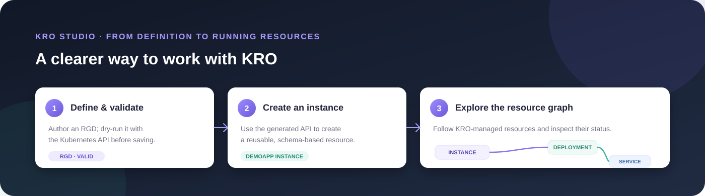

# KRO Studio

**Design KRO ResourceGraphDefinitions, manage their instances, and see every composed resource in one focused Kubernetes UI.**

KRO Studio is an open-source web workspace for [KRO](https://kro.run/). Validate and manage ResourceGraphDefinitions (RGDs), work with the APIs KRO generates, and follow an instance through its composed resources—all through your browser.

> **Project status:** Early-stage, self-hosted project with limited automated test coverage. Start with the local demo below and review the [known limitations and roadmap](docs/roadmap.md) before using it on important clusters.



## Try the local demo

The demo uses a disposable [kind](https://kind.sigs.k8s.io/) cluster and the current Kubernetes context. It installs KRO 0.9.4, applies a sample RGD and instance, and leaves the cluster available for exploration. KRO Studio runs locally in login-free Development mode and talks to the cluster through your kubeconfig.

You need Docker, kind, kubectl, .NET 10 SDK, Node.js 24, and npm. From the repository root:

```sh
bash scripts/demo-kind.sh
```

On Windows PowerShell:

```powershell
.\scripts\demo-kind.ps1
```

Then start the Hub and UI in two terminals:

```sh
dotnet run --project src/Hub --launch-profile http
```

```sh
cd src/Web && npm ci && npm run dev
```

Open the Vite URL (normally <http://localhost:5173>). The sample `DemoApp` RGD and instance are ready to inspect. Create another RGD from **Resource graphs**, validate it with the Kubernetes API dry-run, save it, then create an instance and open its **Resource graph** tab.

The login-free mode is restricted to loopback Development listeners. Keep the demo cluster disposable: the local kubeconfig identity can perform any action it is authorized to perform. Clean up with `kind delete cluster --name kro-studio-demo`.

### Install on a shared cluster

Shared deployments use OIDC. Prepare `values-production.yaml` with the published image, identity provider, allowed hostname, and TLS ingress settings, and create the OIDC client-secret Kubernetes Secret as described in the [Helm deployment guide](deploy/k8s/README.md). Then install the OCI chart:

```sh
helm upgrade --install kro-studio oci://ghcr.io/OWNER/charts/kro-studio \
  --version VERSION --namespace kro-studio --create-namespace \
  --values values-production.yaml
```

Replace `OWNER` and `VERSION` with the published repository owner and release. Keep the local kind walkthrough above for a fast login-free demo.

## What you can do

- **Author RGDs:** create, inspect, update, and delete cluster-scoped ResourceGraphDefinitions.
- **Validate before saving:** ask the Kubernetes API server to dry-run an RGD create or update. This does not save the object and does not replace KRO's later reconciliation status.
- **Manage generated APIs and instances:** discover a generated API from an RGD; list, create, inspect, update, and delete its instances; view conditions and related events.
- **Explore composed resources:** inspect resources declared by the RGD and associated with an instance. The graph skips Secret objects and may show partial results when permissions or discovery are incomplete.
- **Retry KRO work:** request another reconciliation for an RGD or request a rolling restart of the KRO controller deployment.
- **Manage Kubernetes RBAC:** inspect and edit Roles, ClusterRoles, RoleBindings, and ClusterRoleBindings, subject to the active Kubernetes identity's permissions.
- **Deploy with identity controls:** use local kubeconfig access for local development, or OIDC for shared deployments. Optional Kubernetes impersonation is available when the deployment is configured for it.

KRO Studio is a Kubernetes client, not a replacement for the KRO controller. Kubernetes remains the source of truth and KRO reconciles the resources.

## KRO Studio and other tools

| | KRO Studio | `kubectl` | Headlamp / Lens / Rancher |
|---|---|---|---|
| Main focus | KRO RGDs and their generated instances | General Kubernetes CLI workflows | General Kubernetes cluster visibility and administration |
| Interface | Browser UI focused on the RGD → instance → composed-resource path | Commands, manifests, and scripts | General-purpose dashboards; capabilities vary by product, version, and extensions |
| Best fit | People who want a focused visual workflow for KRO | Automation, scripting, precise API control, and users who prefer the CLI | Broad cluster operations across many Kubernetes resource types |
| Trade-off | Early-stage project with a narrower scope and fewer integrations | Requires Kubernetes and KRO command-line familiarity | Availability of KRO-specific authoring and instance workflows depends on each product's integrations and extensions |

These tools serve different jobs and can be used together. KRO Studio does not aim to replace `kubectl` or become a general-purpose dashboard. See the projects' own documentation: [Headlamp](https://headlamp.dev/), [Lens](https://k8slens.dev/), and [Rancher](https://www.rancher.com/).

## Deployment and security

- **Local:** kubeconfig-backed Development mode, restricted to a loopback listener.
- **Shared:** the Helm chart requires OIDC and an explicit hostname allow-list. It creates a ServiceAccount but intentionally grants it no Kubernetes Roles or bindings; configure only the permissions the chosen workflows need.
- **Identity:** shared Helm mode uses the pod's Kubernetes identity by default. Optional impersonation requires an appropriately trusted OIDC claim mapping and Kubernetes permission to impersonate.
- **Hardening:** the chart uses a single replica, non-root execution, a read-only root filesystem, dropped Linux capabilities, and optional ingress and NetworkPolicy resources.

Read the [authentication and RBAC guide](docs/authentication-and-rbac.md) and [deployment/security design](docs/design-document-modes-security-deployment.md) before exposing a shared installation.

## Contributing and project direction

Contributions are welcome. Start with [CONTRIBUTING.md](CONTRIBUTING.md), the [roadmap](docs/roadmap.md), and the published [good first issues](docs/good-first-issues.md). Report vulnerabilities privately using the process in [SECURITY.md](SECURITY.md).

### Roadmap

1. **Make the first workflow dependable:** validate the local quickstart, strengthen end-to-end coverage, and clarify KRO readiness and permission errors.
2. **Improve safe operations:** show instance reconciliation outcomes more clearly and evaluate write previews and RGD deletion impact checks.
3. **Prepare trustworthy releases:** complete security verification, publish signed artifacts and an SBOM, and document supported KRO/Kubernetes versions.
4. **Grow with users:** improve onboarding and accessibility based on feedback, then prioritize integrations requested by KRO users.

This is a direction, not a release commitment. The tracked items and current status live in the [roadmap](docs/roadmap.md).

## Development

The app consists of a React/TypeScript/Vite frontend (`src/Web`) and an ASP.NET Core .NET 10 Hub (`src/Hub`). In development, Vite forwards `/api` requests to the Hub. The single-image Docker build serves the UI and API from the Hub.

```sh
dotnet run --project src/Hub --launch-profile http
```

In a second terminal:

```sh
cd src/Web
npm ci
npm run dev
```

The project has GitHub Actions CI for build, chart validation, container build, and a kind install smoke check. See [architecture and design](docs/architecture-and-design.md) for implementation details and [local OIDC with Keycloak](docs/local-keycloak-oidc.md) for auth development.

## Repository

- [Helm chart and deployment guide](deploy/k8s/README.md)
- [Architecture](docs/architecture-and-design.md)
- [Authentication and RBAC](docs/authentication-and-rbac.md)
- [Roadmap and known limitations](docs/roadmap.md)
- [Demo media capture guide](docs/demo-media.md)
- [Repository launch checklist](docs/repository-launch-checklist.md)
- [Contributing](CONTRIBUTING.md)
- [License](LICENSE)
