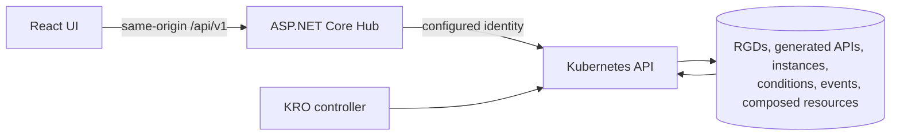

# KRO Studio architecture

**Status:** Current implementation, reconciled on November 11, 2026  
**Scope:** One configured Kubernetes context per running instance

KRO Studio is a browser workspace for creating and managing KRO ResourceGraphDefinitions (RGDs), operating on their generated custom resources, and inspecting composed resources associated with an instance. The [README](../README.md) is the user quickstart, the [roadmap](roadmap.md) tracks unfinished work, and the older [project blueprint](kro-studio-project-documentation.md) is historical planning context.

## Runtime architecture

- **Web UI:** React, TypeScript, Vite, React Query, and React Flow in `src/Web`.
- **Hub:** ASP.NET Core Minimal API on .NET 10 in `src/Hub`. Feature folders define routes and services; shared infrastructure constructs Kubernetes clients, handles auth, and maps errors.
- **Development:** Run the Hub and Vite as separate processes. Vite forwards API requests to the Hub.
- **Container:** The Docker build compiles the UI into the Hub's `wwwroot`; one process serves UI and API on port 8080.
- **Cluster access:** Only the Hub talks to the Kubernetes API. Browser code never receives kubeconfig credentials.

## Supported workflows

### ResourceGraphDefinitions

The Hub lists and reads cluster-scoped RGDs, validates create/update manifests with Kubernetes server-side dry-run, and separately supports create, update, and delete operations. Dry-run does not persist an RGD and does not guarantee KRO will later accept it. The UI displays KRO conditions and generated API availability as subsequent state.

The Hub can request another reconciliation by patching a KRO Studio retry annotation onto an RGD. This is a reconciliation request; it does not synchronously reconcile resources or guarantee acceptance.

### Generated APIs and instances

The Hub resolves an RGD's generated API using Kubernetes API discovery and schema data. Once the API is discoverable, the UI can list, read, create, update, and delete instances. It also displays instance conditions and related events.

The UI displays instance details and YAML alongside a composed-resource graph. The Hub limits inspection to kinds declared in the matched RGD and associates objects using KRO's instance ownership label. Secret objects are skipped. Forbidden or undiscovered resource types can produce partial inspection; the graph is read-only and does not manage child resource lifecycles.

### Controller and RBAC operations

The Hub provides a request to restart the `kro-system/kro` controller Deployment. The UI also manages Kubernetes Roles, ClusterRoles, RoleBindings, and ClusterRoleBindings through Kubernetes APIs. These operations use the effective identity's permissions and can have broad impact; review manifests and RBAC grants carefully.

## Authentication and deployment

- **Local Development:** The documented loopback profile permits `UserAuth:Mode=none` and reads the selected kubeconfig context. Do not bind this mode to a network interface.
- **Shared Helm deployment:** OIDC is required, allowed hostnames must be explicit, and the chart's ServiceAccount is intentionally created without role bindings. Administrators grant only permissions the chosen workflows need.
- **Kubernetes identity:** Shared mode uses the pod identity by default. Optional impersonation requires OIDC claims and a kubeconfig identity authorized to impersonate those users and groups.
- **Pod hardening:** The chart defaults to one replica and runs non-root with a read-only root filesystem and dropped Linux capabilities. Ingress and NetworkPolicy are configurable.

See [authentication and RBAC](authentication-and-rbac.md) and the [Helm deployment guide](../deploy/k8s/README.md) for configuration details.

## Current limitations and follow-up

- One Kubernetes context is configured per running instance; multi-cluster fleet views are not implemented.
- Composed-resource inspection is limited by RGD-declared types, ownership metadata, API discovery, and the effective identity's permissions.
- The project is early-stage and has limited automated test coverage. CI currently builds the .NET solution, validates and packages the chart, builds the container, and performs a kind chart-install smoke check.
- Clearer reconciliation troubleshooting, permission feedback, full security verification, signed releases, and an SBOM remain roadmap items.

See the [roadmap](roadmap.md) and [pending work](to-do.md) for tracked details.
