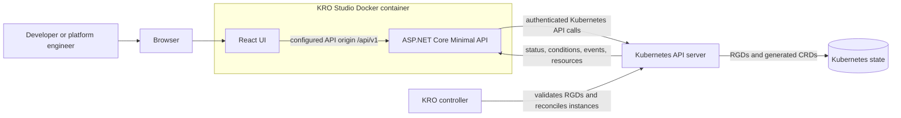
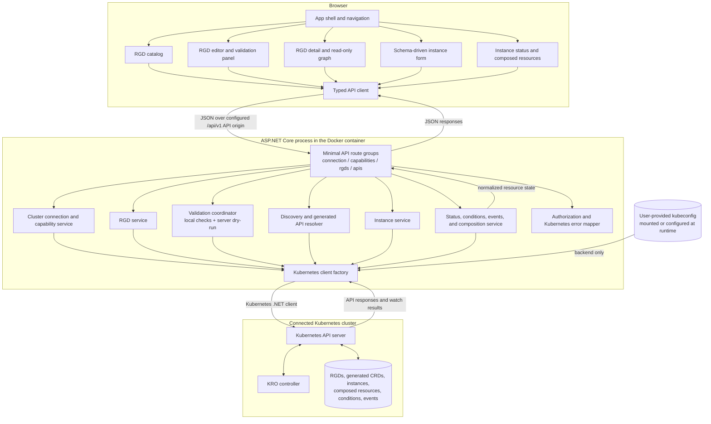

# KRO Studio Architecture and Product Design

**Status:** Proposed MVP design  
**Audience:** Contributors, maintainers, and users evaluating the project  
**Scope:** Local-first KRO management application for one Kubernetes cluster per running instance

This document turns the product requirements into an initial application architecture and user experience. The requirements and broader roadmap live in [the project blueprint](kro-studio-project-documentation.md); detailed authentication and permission requirements live in [authentication and RBAC design](authentication-and-rbac.md). Where an implementation detail is still undecided, this document calls it out rather than treating it as a settled choice.

## 1. Product shape

KRO Studio is a browser-based workspace for two connected jobs:

1. Author, validate, inspect, and manage KRO ResourceGraphDefinitions (RGDs).
2. Create and monitor custom resource instances exposed by an RGD.

The primary flow is:

```text
Connect to a Kubernetes context
        |
        v
Browse and visualize existing RGDs
        |
        +--> Create or edit an RGD --> Validate --> Apply --> Observe KRO status
                                                               |
                                                               v
                                               Generated API becomes ready
                                                               |
                                                               v
                                      Create an instance --> Monitor instance
                                                               |
                                                               v
                                                 Inspect composed resources
```

KRO Studio is a client for Kubernetes and KRO. Kubernetes stores the definitions and instances. KRO validates accepted RGDs, generates their APIs, and reconciles their instances and composed resources. KRO Studio presents those resources and lifecycle states; it does not run a reconciler of its own.

## 2. MVP architecture

### Chosen stack

- **Frontend:** React, TypeScript, and Vite.
- **Backend:** ASP.NET Core Minimal API on .NET 10 LTS, using the Kubernetes .NET client.
- **Packaging:** During current backend work, the ASP.NET Core API and React/Vite UI run and deploy independently. A combined image can be considered later without making it a build or runtime requirement.
- **Cluster access:** The backend uses a kubeconfig supplied at runtime for local operation. Credentials are never included in the source tree, image, or browser bundle.

The browser calls only the KRO Studio API. It does not hold Kubernetes credentials or call the Kubernetes API directly. This keeps cluster access and Kubernetes-specific API handling in the backend. Local UI hosting is independent: the API has no static-file root, fallback page, or build dependency on the UI project. Configure the UI origin in the API's CORS allowlist when it does not use the Vite development proxy.

### Logical architecture



### Low-level component and request flow

This view shows the proposed backend source modules and which component owns each Kubernetes interaction. The browser and API are separate processes in the current development workflow; the single-container packaging shown here is not required.



The route groups validate request shape and delegate domain work to services. Services use the Kubernetes client factory for API calls and discovery; they do not construct frontend-specific responses from raw cluster state independently. The error mapper converts Kubernetes status responses into stable application errors while retaining safe diagnostic details. The kubeconfig is available only to the backend process and never crosses the browser boundary.

For composed-resource inspection, query only resource types declared by the matched RGD and identify live child objects through KRO's instance UID ownership label. Do not depend on owner references, which KRO does not set by default, or scan unrelated resource types. Skip Secrets and report forbidden or undiscoverable types as incomplete inspection.

### Backend responsibilities

- **Cluster connection and capabilities:** Report connectivity and discover whether KRO APIs and expected resources are available.
- **Kubernetes discovery:** Resolve API groups, versions, resource names, and scope dynamically. Do not assume a fixed generated kind or plural name.
- **RGD service:** List, read, create, update, delete, and track RGDs.
- **Validation coordinator:** Run local structural checks in the UI/API and Kubernetes server-side dry-run where supported. Explain that KRO's authoritative processing result arrives after the RGD is persisted.
- **Generated API resolver:** Link an RGD to its generated CRD/API using cluster discovery and verified metadata. Gate instance creation until the API is established and discoverable.
- **Instance service:** List, create, read, update, and delete custom resources using the resolved API and its discovered scope.
- **Status and composition inspection:** Surface conditions and events and discover composed resources only through reliable ownership or KRO-supported metadata.
- **RBAC advisor:** Evaluate the configured studio identity against the operations the selected workflow needs, and diagnose the separate KRO controller identity using RGD status/events plus optional subject access reviews or a clearly labeled RBAC-rule estimate. Preserve the evidence and uncertainty for every result; never grant permissions automatically.
- **Error and authorization mapping:** Present Kubernetes forbidden, conflict, timeout, unavailable, and validation failures clearly without weakening RBAC or exposing credentials.

### Current backend implementation boundary

The Web project is an API-only process. It does not load or serve React assets and does not reference the UI build output. The current local workflow runs Vite and ASP.NET Core independently; the Vite proxy may forward API calls during development, and other UI hosts can call the API through its configured CORS origins. Route groups and services are organized by vertical feature under `Features`, while Kubernetes client construction and exception mapping are shared infrastructure.

### Frontend areas

- **Connection shell:** Active cluster identity, connection state, and KRO capability status.
- **RBAC advisor:** A cluster access view for studio permissions and a separate controller permissions panel on RGD details. Findings identify the principal, action, resource, scope, evidence, and reviewable remediation.
- **RGD catalog:** Searchable list with health/readiness, generated API availability, and links to detail pages.
- **RGD detail:** Overview, schema, resources/graph, instances, YAML, and conditions/events.
- **RGD editor:** Guided metadata/schema entry plus YAML editing and manifest preview.
- **Instance manager:** Schema-driven create/edit forms, YAML fallback, instance status, conditions, events, and composed resources.

## 3. RGD experience

### Browse and visualize existing RGDs

The RGD catalog lists cluster-scoped RGDs and makes their state and generated API availability visible. Selecting an RGD opens a detail page with:

- **Overview:** Identity, labels, timestamps, readiness, and generated API state.
- **Schema:** The inputs that instance creators can provide, including required fields, types, defaults, and constraints.
- **Resources:** A read-only graph of declared resources and dependencies, with a list view for precise inspection.
- **Instances:** Instances resolved to this RGD's generated API.
- **YAML:** The complete manifest for inspection and editing.
- **Conditions and events:** KRO and Kubernetes feedback, with source details retained.

The MVP graph is for understanding an RGD. It does not edit the definition. When relationship data is inferred from expressions or reported by KRO, the UI should distinguish that source and avoid inventing edges it cannot verify. A full drag-and-drop graph authoring experience is outside the initial MVP.

### Create or edit an RGD

The editor should welcome a user with a guided path while retaining full KRO expressiveness:

1. Enter RGD identity and generated API identity.
2. Define the input schema for future instances.
3. Add resource templates and dependencies, including CEL expressions.
4. Review the full generated YAML and read-only dependency graph.
5. Validate, resolve reported errors, and review the final manifest.
6. Explicitly create or update the RGD.
7. Follow KRO's conditions until the definition is accepted or rejected and the generated API is ready or unavailable.

For the initial design, the complete YAML manifest is the interoperability boundary: all valid KRO fields remain inspectable and editable, including fields that guided controls do not understand. Guided controls must not silently discard unknown fields. Resource templates and advanced CEL-heavy areas should allow direct YAML editing rather than forcing users through incomplete forms.

### Validation and lifecycle states

The UI should call each check by what it proves and keep validation separate from persistence:

| Stage | What it can establish | User-facing state |
| --- | --- | --- |
| Local checks | YAML parses and obvious structural requirements pass | Draft has local errors/warnings or is ready for preflight |
| Kubernetes dry-run | The API server accepts the request through applicable schema, admission, and authorization checks without storing it | Preflight passed or rejected |
| Create/update | Kubernetes stored the RGD | Submitted/accepted by API |
| KRO processing | KRO evaluated the actual RGD and reported conditions | Processing, accepted, or rejected by KRO |
| API discovery | The generated CRD is established and served | Instance creation available or pending/unavailable |

Kubernetes dry-run does not persist the RGD. KRO's RGD validation is reflected in conditions after KRO processes a stored definition, so dry-run cannot stand in for the KRO result. The UI must not label an API write as a successful KRO reconciliation. See [Kubernetes dry-run](https://kubernetes.io/docs/reference/using-api/api-concepts/#dry-run) and [KRO resource validation](https://kro.run/docs/concepts/rgd/resource-definitions/resource-basics/).

Recommended actions are **Validate** (non-persisting checks) and **Create RGD** or **Update RGD** (a separately confirmed write). After a write, show the API result immediately, then update the RGD status as KRO conditions change. Preserve resource-version conflict handling when editing an existing definition.

## 4. Instance creation and monitoring

Instance creation is available from an RGD detail page when its generated API is established and discoverable. The backend resolves the generated API dynamically and reads its OpenAPI schema; the UI then:

1. Shows the generated kind, API group/version, and whether instances are namespaced or cluster-scoped.
2. Builds a form from supported schema fields, including required fields, defaults, and enums.
3. Offers YAML mode for advanced or unsupported schema shapes, with a final manifest preview.
4. Submits the instance through the Kubernetes API and distinguishes write success from later reconciliation.
5. Shows the instance's spec, status, conditions, relevant events, and the composed resources KRO created when those can be reliably associated.

The composed-resource view is read-only in the MVP. Users can navigate to a resource's details, but KRO Studio does not independently update or delete KRO-managed children. The normal lifecycle operation is performed on the instance, with clear confirmation for deletion.

## 5. Local deployment and security boundaries

- The container is self-hosted and local-first; a running instance targets one configured Kubernetes context for the MVP.
- The kubeconfig is mounted or supplied at runtime and must not be baked into the image or committed to the repository.
- Bind to loopback by default for local use. A shared or remotely reachable deployment requires an explicit authentication model before enabling access.
- Kubernetes RBAC remains authoritative. RGD create/update operations need cluster-scoped permission; namespace permissions for instances do not grant RGD permissions.
- Do not silently switch to stronger credentials after a forbidden response.
- Redact secrets in logs and avoid rendering Secret payloads in the UI.
- The app can persist its own settings later if needed, but the MVP should not add a database for Kubernetes state.

The exact kubeconfig mount UX remains an implementation decision. The local MVP uses the configured kubeconfig identity; it does not define a separate multi-user login model. User-to-application authentication and backend-to-Kubernetes authentication are separate concerns. See [authentication and RBAC design](authentication-and-rbac.md) for the detailed flow, permission matrix, and shared-deployment prerequisites. Do not expose the container beyond a trusted local machine until shared access is protected by an explicit user authentication and authorization design.

## 6. Initial API boundaries

Use the versioned backend API under `/api/v1`; the UI calls the configured API origin:

- `GET /connection` and `GET /capabilities` for connection and feature readiness.
- An RBAC advisor route group for permission checks and controller diagnostics. Checks are scoped to requested studio features or a selected RGD, and return allowed/denied/unknown with evidence rather than a single all-clear flag.
- `/rgds` for RGD list/read/create/update/delete operations.
- `POST /rgds/validate` for supported non-persisting validation checks.
- `/rgds/{name}/api` to resolve generated API information and `/rgds/{name}/instances` for the RGD-associated collection.
- `/apis/{apiId}/instances` for operations against a dynamically resolved generated API.

These application routes are not Kubernetes routes. The backend resolves resource scope before forming Kubernetes requests, uses bounded timeouts and pagination where appropriate, and returns structured errors suitable for both summary text and detailed diagnostics.

## 7. MVP boundary and later work

**Included in MVP:** existing RGD visualization, RGD create/edit/validation, generated API discovery, schema-driven custom resource creation, instance monitoring, and read-only composed-resource inspection.

**RBAC advisor:** checks the studio kubeconfig identity and separately diagnoses the KRO controller identity. For controller RBAC, it previews narrowly scoped resource rules, shows that the current binding is cluster-wide, and requires explicit review before creating missing managed objects. Evidence and authorization limits are defined in [authentication and RBAC design](authentication-and-rbac.md).

**Deferred:** interactive graph editing, multi-cluster fleet management, Git provider workflows, compatibility analysis/revision history, broad generic Kubernetes management, and hosted SaaS operation.

## 8. Design questions to resolve during implementation planning

1. What is the local kubeconfig handoff: a documented volume mount, a configurable path, or both?
2. Which exact KRO and Kubernetes versions are supported in the first alpha?
3. How much of the schema and resource-definition workflow can be guided without narrowing valid KRO syntax? The safe baseline is guided metadata/schema with YAML-first resource templates.
4. Which official KRO status fields and metadata are stable enough to drive graph edges and generated API association for the pinned version?

