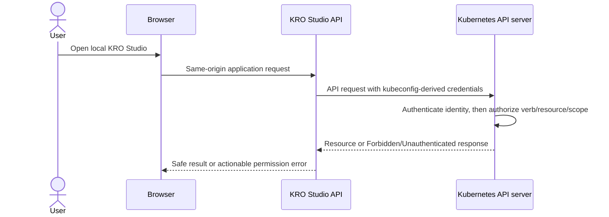

# KRO Studio Authentication and RBAC Design

**Status:** Current authentication and authorization behavior
**Audience:** Contributors, cluster administrators, and users deploying KRO Studio  
**Related documents:** [Architecture and design](architecture-and-design.md), [project blueprint](kro-studio-project-documentation.md)

This document specifies how a person accesses KRO Studio, how the backend authenticates to the Kubernetes API server, and what Kubernetes permissions the supported workflows require. These are separate trust boundaries: logging in to the web application does not itself grant Kubernetes permissions.

## 1. Decisions and boundaries

KRO Studio supports local kubeconfig use and OIDC-authenticated deployments. The browser talks only to the same-origin KRO Studio API; it never receives Kubernetes tokens, client keys, certificates, or kubeconfig contents. Kubernetes authenticates the backend's requests and authorizes each request using the effective Kubernetes identity's RBAC grants.

| Concern | Local development | Shared deployment |
| --- | --- | --- |
| Person to KRO Studio | Login-free `UserAuth:Mode=none` is allowed only on local Development listeners; local OIDC can also be used for auth development | OIDC provider configured by `UserAuth:Oidc:*` |
| KRO Studio backend to Kubernetes | `Kubernetes:AuthMode=serviceAccount` uses the runtime kubeconfig locally or the pod's service account with in-cluster configuration | `Kubernetes:AuthMode=impersonation` uses a kubeconfig base identity and forwards verified OIDC username/group claims as Kubernetes impersonation headers |
| Kubernetes authorization | Kubernetes RBAC is authoritative; no permission is inferred from hidden UI controls | Still authoritative; application identity-to-cluster identity mapping must be designed before team access |
| Credential delivery | Runtime file/configuration to backend only; never image, repository, or browser bundle | Secret and identity lifecycle must be owned by the deployment platform |

OIDC user authentication and Kubernetes authentication are independent settings. Impersonation requires `UserAuth:Mode=oidc`; OIDC establishes the caller and the Kubernetes client uses a configured kubeconfig identity that must be authorized to impersonate the requested users and groups. The Helm chart uses the pod service account for Kubernetes calls, so its permissions are shared by signed-in users. Do not expose `UserAuth:Mode=none` to untrusted networks; the Hub rejects it outside local Development listeners.

### Runtime configuration

Set `UserAuth:Mode=oidc`, `UserAuth:Oidc:Authority`, and `UserAuth:Oidc:ClientId` to enable sign-in. Supply `UserAuth:Oidc:ClientSecret` through a secret store or environment variable when the provider requires a confidential client. The provider must allow the Hub callback at `/signin-oidc`. The login endpoint is `/auth/login`; logout is a POST to `/auth/logout`. The API returns 401 for unauthenticated API calls.

Set `Kubernetes:AuthMode=serviceAccount` to use the backend identity. For a pod deployment, set `Kubernetes:InCluster=true` and grant the pod's service account the required RBAC. For a local service-account identity, leave `InCluster=false` and provide `KUBECONFIG` or `Kubernetes:KubeconfigPath` (and optionally `KUBECONTEXT`).

Set `Kubernetes:AuthMode=impersonation` to use the authenticated identity. Configure `UserAuth:Oidc:UsernameClaim` (default `preferred_username`) and `UserAuth:Oidc:GroupsClaim` (default `groups`) to match the provider's claims. The Hub sends those values through Kubernetes `Impersonate-User` and `Impersonate-Group` headers. The configured base Kubernetes identity must have the Kubernetes `impersonate` verb for the corresponding users and groups. The OIDC access token is not sent to Kubernetes. A missing username claim fails closed. Impersonation uses a kubeconfig identity as its credential source and cannot be combined with `Kubernetes:InCluster=true`.

### BFF browser session

In OIDC mode, React obtains session state from `GET /auth/session` and starts login with a top-level navigation to `/auth/login`. The Hub completes the authorization-code flow, validates the OIDC response, and stores the authentication ticket in `IDistributedCache`; the browser receives an HttpOnly cookie containing only an opaque ticket key. Access and refresh tokens are not retained; the ID token is kept only in the server-side ticket to support provider logout. No OIDC token is exposed to React. API calls are same-origin and use the session cookie automatically. `GET /auth/session` also issues the antiforgery request token; React sends it in `X-CSRF-TOKEN` for every unsafe `/api/v1` request, while the sign-out form posts it as the antiforgery form field. The Hub checks that token before allowing a mutation. Unauthenticated API requests return 401 rather than redirecting an XHR to the identity provider.

The default cache is process-local memory for a single Hub instance. Multi-instance production deployments must provide a shared `IDistributedCache` and shared protected Data Protection keys. Set up TLS at the browser-facing endpoint and ensure forwarded host/protocol handling is configured correctly when TLS terminates at a proxy. Follow [the local Keycloak guide](local-keycloak-oidc.md) for a complete development walkthrough.

## 2. Two authentication hops

The first hop is **user-to-application authentication**. It determines who may use the web application and protects browser sessions. The second is **backend-to-Kubernetes authentication and authorization**. It determines the Kubernetes principal used for API calls and whether that principal may perform a particular operation. A successful app login is not a Kubernetes grant; a valid kubeconfig is not proof that a web user should be allowed into a shared app.

## 3. User stories

### 3.1 Connect using the configured Kubernetes identity (MVP)

**As a local KRO Studio operator,** I want the backend to connect to the Kubernetes API server using the runtime kubeconfig's selected context, so that KRO Studio can show and manage only the resources my Kubernetes identity is allowed to access.

**Acceptance criteria**

- The deployment instructions explain how to supply a kubeconfig at runtime and how the current context is selected/configured.
- The backend constructs Kubernetes clients from the configured kubeconfig; the browser receives neither the file nor derived credentials.
- A connection/capabilities view distinguishes unreachable API server, failed authentication, missing KRO APIs, and insufficient authorization.
- Requests use the configured identity consistently. A `Forbidden` response is returned as a permission failure; the backend never retries with a broader identity or silently changes context.
- Kubeconfig parsing, TLS verification, credential refresh, and supported credential-provider behavior are delegated to the selected Kubernetes client library where supported. The supported kubeconfig features and runtime dependencies are documented and tested for the release.
- Exec credential plugins, when used, run in the backend's runtime environment. Interactive plugins that require a workstation prompt cannot be assumed to work in a headless container; failures explain that the configured credential mechanism needs attention.
- Logs and API errors never include bearer tokens, private keys, client certificates, or kubeconfig contents.

### 3.2 Read and operate on KRO resources within granted permissions

**As a Kubernetes administrator,** I want KRO Studio to use a least-privilege identity and report exactly which operation was denied, so that I can grant only the Kubernetes permissions needed for the intended workflow.

**Acceptance criteria**

- Read-only discovery can be used without granting write permissions.
- RGD authoring permissions are separate from instance permissions and are explicitly cluster-scoped because RGDs are cluster-scoped.
- Instance permissions are bound at the scope of the generated resource: namespace-scoped for namespaced instances, cluster-scoped for cluster-scoped instances.
- A denied list/read/write or composed-resource lookup is shown as denied or incomplete data, never as an empty result or a healthy state.
- The error identifies the attempted action and resource type/scope where Kubernetes provides that information, without exposing credentials.
- The UI may disable an operation when known to be unavailable, but every operation is still authorized by the API server. UI visibility is not a security boundary.

### 3.3 Authenticate users in a shared deployment

**As a team member,** I want to sign in through the organization's approved identity provider before using a shared KRO Studio deployment, so that an unauthenticated visitor cannot use the app's Kubernetes identity.

**Behavior and operator requirements**

- Configure OIDC and its callback URI before exposing the service; anonymous mode is not available in release deployments.
- Choose explicitly between the chart's shared pod identity and OIDC impersonation backed by a kubeconfig identity authorized to impersonate the mapped users/groups.
- Protect OIDC client secrets and kubeconfig credentials as runtime secrets. Apply TLS and configure exact trusted proxy and allowed host values.
- Treat Kubernetes RBAC as the authorization boundary. In shared service-account mode, all signed-in users have the effective permissions of that account.
- The Hub validates sessions and CSRF tokens for unsafe requests and logout. Tickets are server-side; the default cache is in memory and the chart runs one replica.

## 4. Kubernetes API server authentication design

### 4.1 MVP connection flow

1. The operator supplies a kubeconfig to the backend runtime (for example, a mounted read-only file or configured path). It is not committed or copied into the image.
2. The backend loads the configured context and creates a Kubernetes client. Cluster endpoint and TLS trust settings come from that configuration.
3. The Kubernetes client presents the configured credential mechanism to the API server. Depending on the kubeconfig and client support, this may use a token, client certificate, or exec credential plugin.
4. Kubernetes authenticates the principal, then its configured authorizer (RBAC in the expected deployment) decides each request based on verb, API group/resource, subresource, namespace, and name.
5. KRO Studio maps the response into a stable application result. `401`/authentication failures, `403`/authorization failures, connectivity errors, and KRO capability gaps remain distinct.

KRO Studio does not mint Kubernetes tokens or upload credentials from the browser. Credential refresh is performed by the Kubernetes client/configured provider. Kubeconfig exec plugins run with the backend process's privileges; mount only trusted configuration and provide required executables intentionally. In impersonation mode, the configured kubeconfig identity authenticates to Kubernetes and the Hub adds impersonation headers based only on the authenticated OIDC identity and configured claims.

### 4.2 Credential handling requirements

- Keep kubeconfig files and referenced credentials outside source control, image layers, static web assets, and ordinary app settings.
- Mount credentials read-only when the deployment platform permits it; restrict file access to the backend process identity.
- Do not provide a web form that uploads arbitrary kubeconfig files as part of the MVP.
- Avoid returning raw Kubernetes client exceptions or configuration values to the browser.
- Do not log request authorization headers, exec-plugin output, token response bodies, or credential-bearing environment variables.
- Do not disable API-server certificate validation to make a connection work.
- Document that rotating or expiring credentials may require provider refresh or operator action; display connection/authentication state instead of retrying indefinitely.

## 5. Kubernetes RBAC requirements

Kubernetes permissions are additive. Administrators can grant the requirements below through their own Role/RoleBinding and ClusterRole/ClusterRoleBinding policy. KRO Studio does not create, edit, or bind roles for the user. Exact API resource names and scope must be confirmed from discovery and the supported KRO release; the table describes application behavior, not a universal ready-to-apply manifest.

### 5.1 Permission matrix

| Feature / operation | Resource scope | Minimum verbs expected | Notes |
| --- | --- | --- | --- |
| API discovery and capability checks | Non-resource discovery endpoints and API resources | `get` for discovery; resource-specific `get`/`list` as needed | Discovery is needed to resolve API groups, versions, names, and scope. Do not assume every cluster applies identical discovery access policy. |
| Browse and inspect RGDs | Cluster-scoped RGD resource (`kro.run`, currently `resourcegraphdefinitions`) | `get`, `list` | `watch` only if the implementation uses watches; otherwise polling does not need it. |
| Create or update an RGD | Cluster-scoped RGD | `create`, `update` and/or `patch` according to the HTTP operation used | Dry-run uses the same authorization as the corresponding create/update request; dry-run is not a separate RBAC verb. |
| Delete an RGD | Cluster-scoped RGD | `delete` | High-impact operation; keep separate from read-only access and require UI confirmation. |
| Read RGD status/subresources, if addressed separately | Cluster-scoped RGD subresource(s) | `get`; possibly `watch` | Grant only if the client calls the subresource endpoint. Reading the object's status as part of `get` does not by itself require a separate status rule. |
| Inspect generated CRD/API metadata | Cluster-scoped `customresourcedefinitions.apiextensions.k8s.io` | `get`, and `list` only if discovery searches by listing | KRO creates/manages CRDs. KRO Studio only reads them; it does not need CRD create/update/delete. |
| List/read generated instances | Generated custom resource, namespaced or cluster-scoped per its CRD | `get`, `list` | Bind to selected namespaces for namespaced instance APIs; cluster-wide listing requires cluster-wide permission. |
| Create/update/delete generated instances | Generated custom resource, same scope as above | `create`, `update` and/or `patch`, `delete` | Grant each mutation only when that workflow is enabled. A namespaced instance grant does not grant RGD access. |
| Read events for an object | Usually namespaced core `events` (and, if supported, `events` API group) | `get`, `list`; `watch` only for watches | Event access may be needed in each namespace shown. Events are supplemental diagnostics; denial must not hide the primary object's state. |
| Inspect composed resources | Each composed resource GVR and applicable namespace | `get`, `list` for supported resource types | There is no single safe generic permission for arbitrary composed resources. Resource type and namespace coverage must be explicitly configured. Never grant Secret reads just to support this view. |

The `resourcegraphdefinitions.kro.run` name and `kro.run/v1alpha1` API are the current KRO API documented by KRO. Pin and verify these identifiers against the supported KRO release. KRO's own controller permissions are separate: permissions required by the controller to reconcile an RGD must not be copied wholesale to the KRO Studio identity.

### 5.2 Suggested grant profiles

**Read-only discovery profile**

- Read/list RGDs and their required status information.
- Read the CRD metadata needed to resolve generated APIs.
- Read/list only the generated instance APIs and namespaces intended for this user.
- Read relevant events and explicitly supported composed-resource types if those screens are enabled.
- No create, update, patch, or delete permissions.

**RGD author profile**

- Read-only discovery permissions above.
- `create`, `update`/`patch` on the cluster-scoped RGD resource; add `delete` only if RGD deletion is enabled for that user.
- No permission to create or modify CRDs merely because KRO creates a CRD from the RGD.

**Instance operator profile**

- Read-only discovery permissions above.
- Required mutation verbs on approved generated custom resource types and scopes.
- No RGD mutation unless separately granted.

These profiles are conceptual grants, not predefined Kubernetes roles shipped by the MVP. A cluster administrator should tailor namespace coverage, generated API resource lists, composed-resource types, and delete access to the deployment. KRO RGDs can define resources with broad effects; permission to create or change an RGD is therefore a high-trust capability. In KRO's current access-control guidance, the project warns that RGD creation can amount to broad cluster access depending on controller permissions and configuration. Review the cluster's KRO access-control mode and restrict RGD authors accordingly.

### 5.3 Role scope and bindings

- Use a `ClusterRole` for cluster-scoped RGD operations and CRD metadata reads.
- A `ClusterRole` containing namespaced instance permissions can be bound with a `RoleBinding` in each approved namespace to limit those rules to that namespace.
- Use a `ClusterRoleBinding` only when cluster-wide access is intended, such as access to cluster-scoped generated instances or deliberate all-namespace viewing.
- Do not bind a read/write ClusterRole cluster-wide solely for convenience when namespace-specific RoleBindings meet the requirement.
- Never include `secrets` in broad read permissions. Composed-resource discovery must skip Secrets by default and return a redacted reference only when it can be obtained safely from the parent object or supported metadata.
- Avoid wildcards (`*`) for API groups, resources, and verbs. Add permissions as supported resource types and operations become known.

## 6. User-facing connection and authorization behavior

KRO Studio should classify failures as follows:

| Condition | User-facing result | Expected next step |
| --- | --- | --- |
| API server unreachable / TLS failure | Cluster unavailable, with safe connection detail | Check endpoint, network, CA trust, and server status |
| Credential missing, expired, or rejected | Kubernetes authentication failed | Refresh/configure the kubeconfig credential provider |
| Kubernetes returns `Forbidden` | Permission denied for the requested operation | Ask a cluster administrator for the specific resource/scope/verb |
| KRO API absent | Connected, but KRO is not detected | Install or enable a supported KRO version |
| Generated API not established yet | RGD is processing; instance API pending | Wait for KRO conditions and discovery |
| Some child/event reads are forbidden | Partial inspection; inaccessible data identified | Grant optional read permissions only if that view is required |

The backend must not translate `Forbidden` into an empty list, silently fall back to a different credential, or mark incomplete observations as healthy. A read failure on optional events or a child resource should not erase a successfully retrieved RGD or instance.

### 6.1 RBAC advisor

KRO Studio should provide an RBAC advisor that reports whether the configured Kubernetes identity can perform the operations exposed by the current studio workflow, and separately diagnoses whether KRO's controller appears able to reconcile a selected RGD. These are different identities and must be shown as separate checks:

1. **Studio access:** the identity loaded from the runtime kubeconfig. Check the API operations KRO Studio itself needs, such as discovering APIs, reading RGDs, validating and writing RGDs, reading generated instances, and inspecting supported composed resources. Report each operation as allowed, denied, or unknown, with its verb, API group/resource, and namespace or cluster scope.
2. **Controller access:** the KRO controller service account (normally `kro-system:kro`) and the operations implied by a stored RGD. For example, a generated `webapps.kro.run` API needs `get`, `list`, `watch`, and `patch` on instances so it can read, observe, and update instance metadata/finalizers; `get`, `update`, and `patch` on `webapps/status`; and `update` on `webapps/finalizers`. Resource templates may require create, get, list, watch, update, patch, or delete on their composed resource types. Report these findings independently of the studio's kubeconfig permissions.

The advisor should run after connecting, when an RGD is applied or its conditions fail, and on demand from the RGD detail/status view. It should explain what was checked, which checks could not be completed, and the evidence behind each finding. When an instance name is supplied, inspect its conditions and related events so conditions such as `ManagementFailed` can be viewed beside the controller permission checks. A useful controller finding links the failed RGD or instance condition/event (for example, informer `403 Forbidden` / cache sync timeout) to the implicated resource rule and scope. Do not collapse a partial or unknown result into “permissions are fine.”

#### Checking the studio identity

Use Kubernetes authorization review APIs for explicit probes where available, such as `SelfSubjectAccessReview` for the configured caller. Probe only the finite permission matrix for the selected feature and resolved API scope; do not ask users for credentials or send kubeconfig data to the browser. `SelfSubjectRulesReview` may help summarize namespace rules but its result can be incomplete and is not proof that every operation is allowed. The actual operation remains authoritative: a later `403` updates the relevant finding to denied and preserves the exact attempted verb/resource/scope when safe.

#### Checking the controller identity

The controller check must not pretend the studio's own `SelfSubjectAccessReview` answers for KRO. Prefer evidence in this order:

- Read the RGD's KRO conditions, related events, and (when permitted) controller logs for explicit authorization failures.
- When the studio identity is authorized to create `SubjectAccessReview` objects, ask the API server to evaluate the specific controller service-account subject and each derived action. This optional capability must be detected and explained; do not require it for ordinary studio operation.
- Otherwise, inspect the controller service account's RoleBindings/ClusterRoleBindings and referenced Role/ClusterRole rules, then compare those grants with actions derived from the RGD. Label this as an RBAC configuration estimate, not a definitive authorization decision: aggregated roles, external authorizers, admission behavior, or policy changes may make the effective result differ.

The advisor must identify the controller service account and namespace from the installed KRO workload/configuration when possible. If it cannot identify them reliably, ask the user to select or confirm the subject in the UI and show the assumption. A failure to read RBAC objects or logs is “unknown,” not “denied” or “allowed.” Never infer controller permissions from the studio identity's grants.

#### Results and remediation

Each finding should include identity, check, status (`allowed`, `denied`, `unknown`, or `observed failure`), required action, resource API group/name, scope, evidence/source, and a suggested least-privilege remediation. Distinguish a proven API-server review result from static Role rule analysis and from an observed controller error. The controller RBAC workflow previews the exact `ClusterRole` and `ClusterRoleBinding`, shows their all-namespace impact and manifest, then requires an explicit user checkbox before applying. It creates missing objects and may update a studio-managed ClusterRole only when its current grants are a subset of the newly reviewed rules; it never overwrites unrelated or broader grants, or changes a ClusterRoleBinding. The apply request is rejected if the plan changed since review. It does not edit or delete existing service accounts. Avoid wildcard permissions and never recommend Secret reads as a generic composed-resource permission.

The advisor is diagnostic, not a security boundary. Its output is time-sensitive and can become stale when bindings, admission policy, API discovery, or the RGD changes. Display when checks ran and provide a recheck action. A complete success means only that the checked operations were authorized at that time; it does not prove that KRO can successfully reconcile every valid RGD.

## 7. Implementation status and operator checks

The following behavior is implemented; operators remain responsible for configuring and validating their own identity provider, credentials, and RBAC:

1. Set `Kubernetes:AuthMode` explicitly for the intended mode. Use `KUBECONFIG` / `KUBECONTEXT` or `Kubernetes:KubeconfigPath` / `Kubernetes:Context` for a local kubeconfig. The chart configures in-cluster service-account mode.
2. For shared use, configure OIDC, `auth.allowedHosts`, TLS, and trusted proxies. Keep the OIDC client secret in a Kubernetes Secret referenced by the chart.
3. Grant only the permissions required by intended features. The chart creates no role bindings; review the permission matrix above and use namespace RoleBindings where possible.
4. Choose service-account mode when a shared Kubernetes identity is intentional. Choose impersonation only when the provider's username/group claims are trustworthy and the base identity is limited to the intended impersonation subjects.
5. Validate the actual operations against the target cluster. Discovery and permission summaries are not a substitute for Kubernetes authorization on each request.

## 8. Out of scope

- A username/password database or local account administration UI.
- Browser-held Kubernetes credentials, token paste, direct browser-to-cluster API calls, or kubeconfig upload.
- Persistent or multi-replica session storage by default; the chart is limited to one replica.
- Application roles that replace Kubernetes RBAC.
- Automatic RBAC changes without a reviewed plan and explicit confirmation; editing or deleting existing RBAC objects.
- Broad arbitrary resource management beyond the documented KRO workflows.

## 9. References

- [Kubernetes authentication](https://kubernetes.io/docs/reference/access-authn-authz/authentication/)
- [Kubernetes RBAC authorization](https://kubernetes.io/docs/reference/access-authn-authz/rbac/)
- [Kubernetes API concepts and subresources](https://kubernetes.io/docs/reference/using-api/api-concepts/)
- [KRO ResourceGraphDefinition API](https://kro.run/api/crds/resourcegraphdefinition/)
- [KRO access control](https://kro.run/docs/advanced/access-control/)

